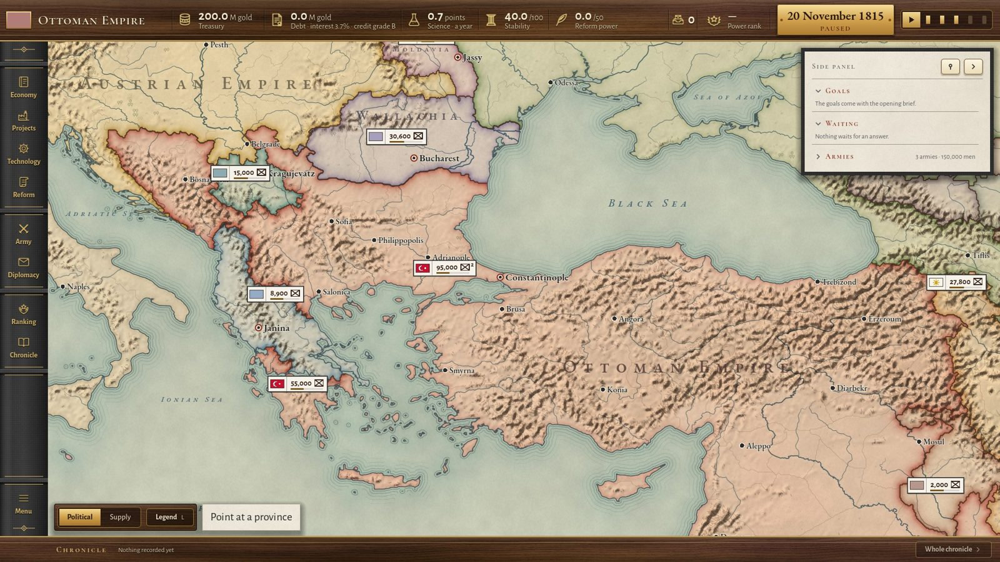
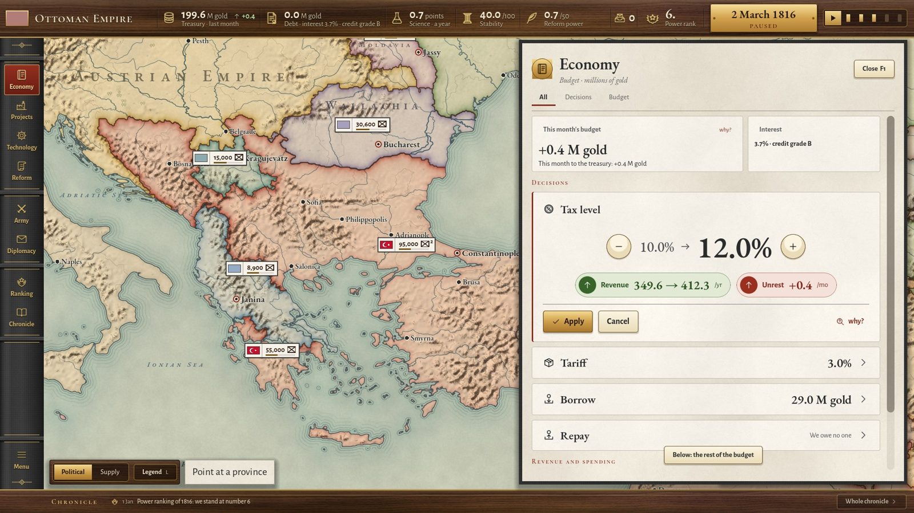
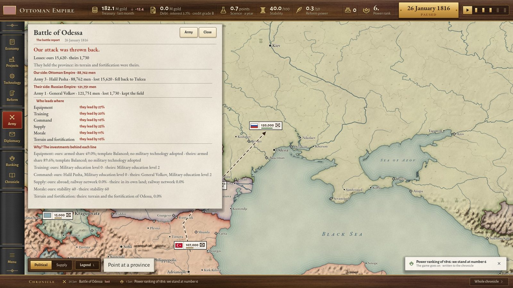
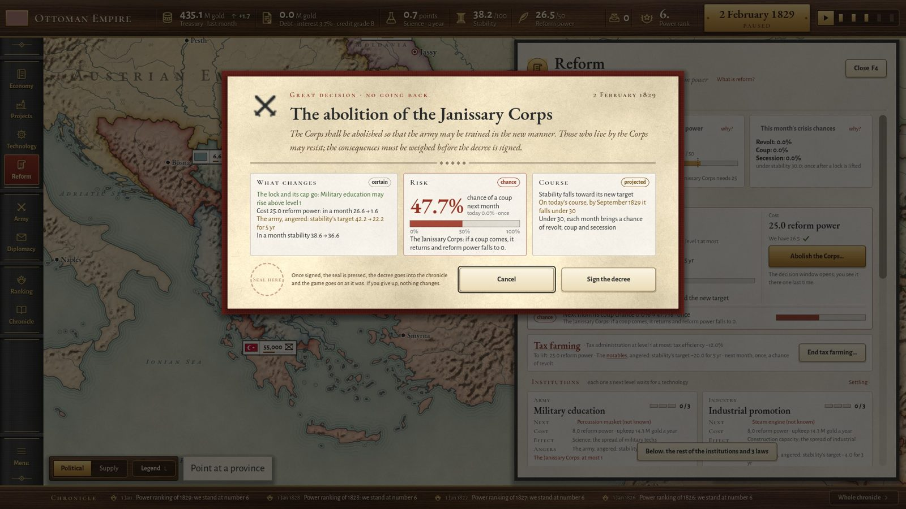
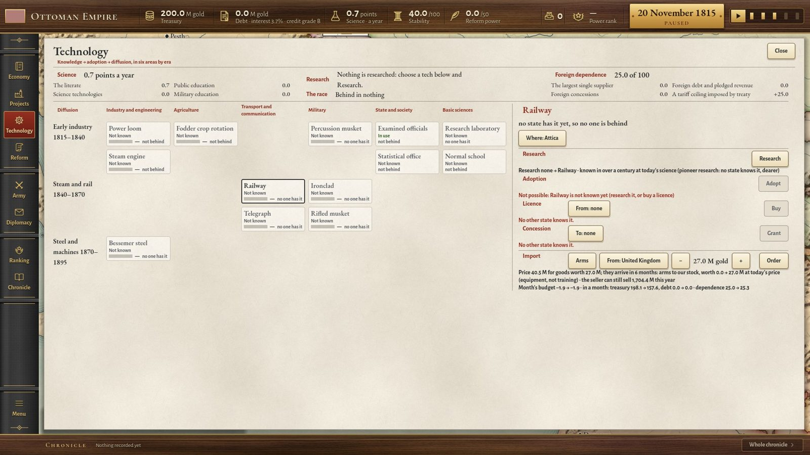
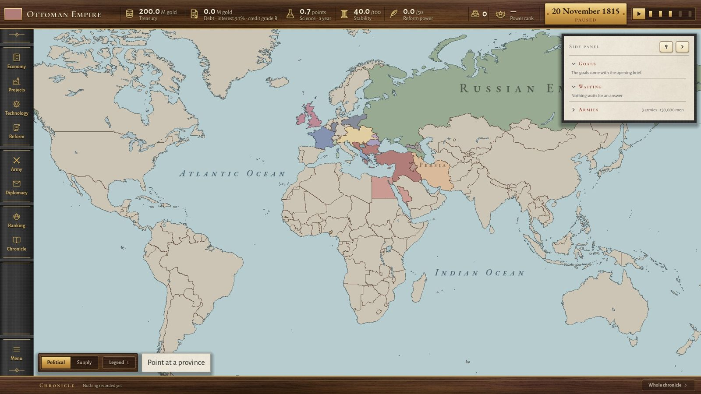

# Proje 1815

**A historical grand-strategy game for PC, in development (Godot 4).** You take over a state that has
fallen behind in 1815 and modernise it by 1914: schools, factories, railways and reforms. Then you use
that strength in war and diplomacy, and every result tells you *why* it happened.

▶ **[Play the browser prototype](https://ertastolga.github.io/1815-deneme/)** (Turkish, runs in any browser)

> The game itself is being prepared for a commercial Steam release, so its source code is in a private
> repository. This public repository holds the playable browser prototype and this overview. I can give
> access to the private repository for a job application if you ask.

## What the game is

- **Pausable real-time strategy**, 1815–1914, on a full world map where every country is playable.
- **Six verbs, the same in every country:** budget and debt, projects, technology, reform, diplomacy, army.
- **Readable cause and effect:** every number keeps its sources. A tooltip, a battle report or a
  ten-year report can say which school, factory or railway made the difference.
- **Look:** a 19th-century atlas map drawn by code from public-domain geographic data.

## My role

I started the project on 12 October 2026 and run it as the product owner and designer:

- wrote the concept and the design rules, and make every product decision (logged with dates in a decision log)
- broke the work into small stages, each ending with something I can play or look at, with written "done when" criteria
- playtest every build and turn my feedback into the next steps. After one test I stopped feature work and ordered an ergonomics pass first
- built the browser prototype here as a design lab and ran a playtest survey with friends (play time, three key decisions, "would you continue?")
- did market research, a pricing analysis and a trademark search for the game's name

## Technical overview

| | |
|---|---|
| Engine and language | Godot 4.7.2, GDScript; Python for offline tools |
| Size (Nov 2026) | ~117,000 lines of GDScript in 320 files (game UI ~29k, simulation ~33k, tests ~56k) |
| Architecture | Pure simulation layer (no UI) driven by commands; the player and the AI use the same command layer |
| Content | Data-driven JSON (goods, buildings, technologies, reforms, states, events), ready for modding |
| Determinism | Seeded random numbers: the same seed and build replay the same campaign |
| Tests and CI | 174 test scripts run headless on every push with GitHub Actions, including checks that the AI changes the world only through the command layer |
| Map pipeline | Python: Natural Earth vector data → Lambert conformal conic projection → province-ID raster and atlas-style art |
| Localisation | Turkish and English; every string comes from a key; prepared for six languages |

## Screenshots

| | |
|---|---|
|  |  |
| **Economy:** tax changes with their effect shown before you apply them | **Battle report:** losses and the reasons behind them |
|  |  |
| **Decision card:** a historical reform with its risk | **Technology:** research and technology transfer |

## How it is made

I build this game together with an AI assistant, **Claude** (Anthropic). I direct the work: the design,
the priorities, the testing and every decision. Claude writes the code under written rules (small steps,
an independent review before each step closes, automated tests). No image-generating AI is used for the art.

---

## Türkçe

**Proje 1815**, Godot 4 ile geliştirdiğim tarihî bir büyük strateji oyunu. 1815'te geri kalmış bir devleti
1914'e kadar okul, fabrika, demiryolu ve reformlarla modernleştirip bu gücü savaşta ve diplomaside
kullanıyorsun. Her sonuç nedenini gösteriyor.

- **[Tarayıcı prototipini oyna](https://ertastolga.github.io/1815-deneme/)**
- Oyun Steam'de satışa hazırlandığı için kaynak kodu gizli bir depoda. İş başvurusu için istenirse erişim verebilirim.
- Rolüm: ürün sahibi ve tasarımcı. Oyunun tasarımını ve bütün ürün kararlarını ben veriyorum, her sürümü test ediyorum,
  arkadaşlarımla oyun testi anketi yaptım, pazar ve fiyat araştırması yaptım.
- Teknik: Godot 4.7.2 (GDScript), yaklaşık 117.000 satır kod, 174 test betiği, GitHub Actions ile otomatik test,
  Python ile harita üretim hattı, JSON ile veri odaklı içerik, Türkçe ve İngilizce.
- Kodu, yönlendirmem ve kurallarım altında yapay zekâ yardımcısı **Claude** (Anthropic) yazıyor.
